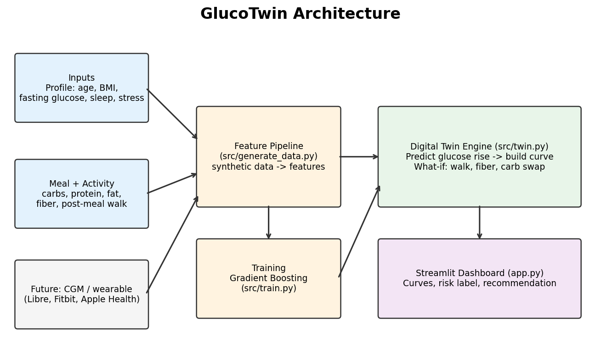

# 🩺 GlucoTwin

**A digital twin that predicts how your blood sugar will react to a meal, before you eat it.**

Happiest Health Digital Twin Hackathon, Prototype & Code Submission

🌐 **Live website:** https://claude.ai/artifact/4oCZndNZnQH3177tA5Vexo

---

## Team
- **Team name:** Hackzz
- **College:** IIT (BHU), Varanasi

## Project Title
GlucoTwin: a metabolic digital twin for prediabetes prevention

## Problem Statement
Over 100 million people in India live with diabetes, and a similar number have prediabetes. Everyone's blood sugar reacts differently to the same food, depending on sleep, stress, weight, age and what else is on the plate. Generic diet advice doesn't capture this, and glucose monitors are costly and only show a spike *after* it happens.

People need a safe, simple way to **test food and lifestyle choices before making them**.

## Healthcare Use Case
**Preventive care for prediabetes.**

The user enters a basic profile and a meal. GlucoTwin predicts their glucose curve for the next 3 hours, then tests a healthier plan (fewer carbs, more fiber, a 15-minute walk after eating) and shows both curves side by side with the predicted drop in the peak.

Useful for individuals, dieticians, wellness coaches and health programs.

## How It Works
1. **Input:** age, BMI, fasting glucose, sleep, stress, and the meal's carbs, protein, fat and fiber
2. **AI model:** predicts the peak rise in glucose
3. **Twin engine:** turns that into a 3-hour glucose curve and runs "what-if" plans
4. **Dashboard:** shows the result and a plain-language recommendation

## Technical Stack
| Part | Tool |
|---|---|
| Language | Python 3.10+ |
| Data | Synthetic dataset (NumPy, pandas), no real patient data |
| AI/ML | scikit-learn |
| App | Streamlit (full app) and a browser version (live website) |
| Testing | pytest |

## AI/ML Model Details
- **Model:** Gradient Boosting Regressor (300 trees, depth 3)
- **Inputs (10):** carbs, protein, fat, fiber, sleep, stress, age, BMI, fasting glucose, minutes walked after the meal
- **Output:** peak glucose rise above fasting level (mg/dL)
- **Curve:** the peak is turned into a rise-and-fall curve. Fat and protein delay the peak; walking brings it down faster.
- **Accuracy:** average error about 4.8 mg/dL, R² about 0.97 on a held-out test set

> Note: the model is trained on synthetic data, so these results show that the pipeline works. It is a proof of concept, not a clinically validated tool.

## Architecture Diagram
📄 [docs/architecture.pdf](docs/architecture.pdf)



## Presentation
📊 [docs/GlucoTwin_Presentation.pdf](docs/GlucoTwin_Presentation.pdf) (PowerPoint version: [docs/GlucoTwin_Presentation.pptx](docs/GlucoTwin_Presentation.pptx))

## Run It Yourself
Open a terminal in the project folder (the one containing `app.py`) and run:
```bash
pip install -r requirements.txt
python -m src.train
streamlit run app.py
```
Then open http://localhost:8501 in your browser.

To run the tests: `python -m pytest -q tests`

## Project Structure
```
app.py                Streamlit app
src/generate_data.py  creates the synthetic dataset
src/train.py          trains the model
src/twin.py           digital twin engine and what-if plans
tests/                automated tests
docs/                 architecture diagram and presentation
```

## Future Plans
- Calibrate with real, consented CGM data
- Connect smartwatches and fitness apps
- Add Indian foods (idli, dosa, roti, dal, rice) with automatic nutrition lookup
- Multilingual AI coach (English, Hindi, Kannada)

## Limitations
- Uses synthetic data; not medical advice
- People with diabetes should follow their doctor's guidance
- The prototype collects and stores no personal health data

## License
MIT License. See [LICENSE](LICENSE).

## Public Access
All files and links in this repository are publicly accessible without additional permissions.
